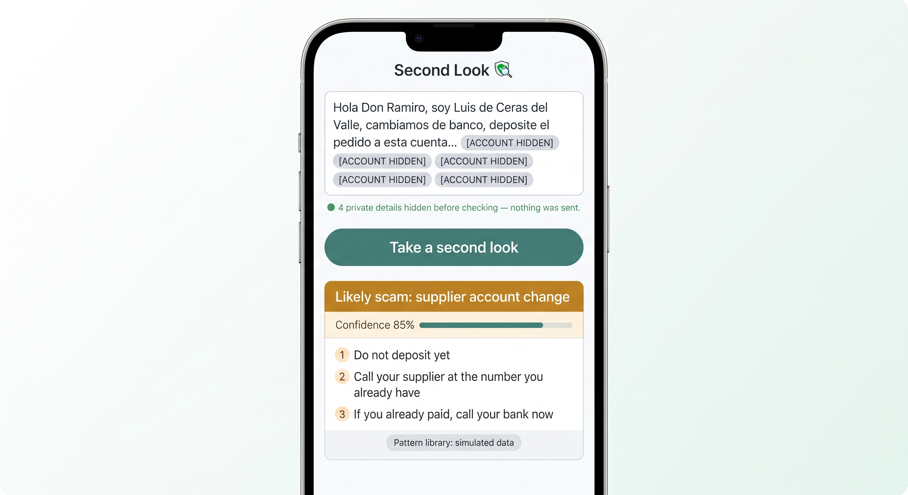
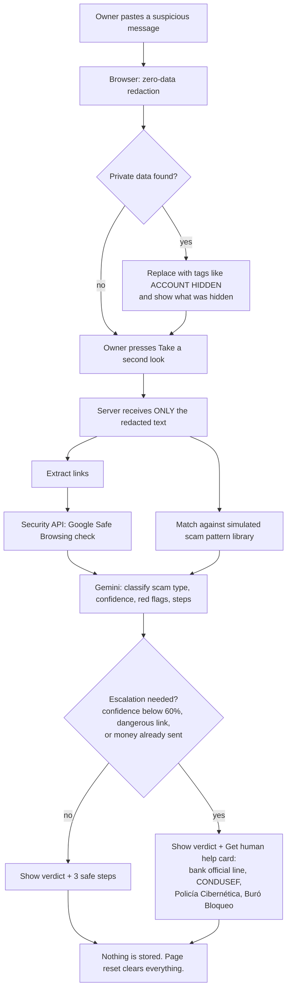
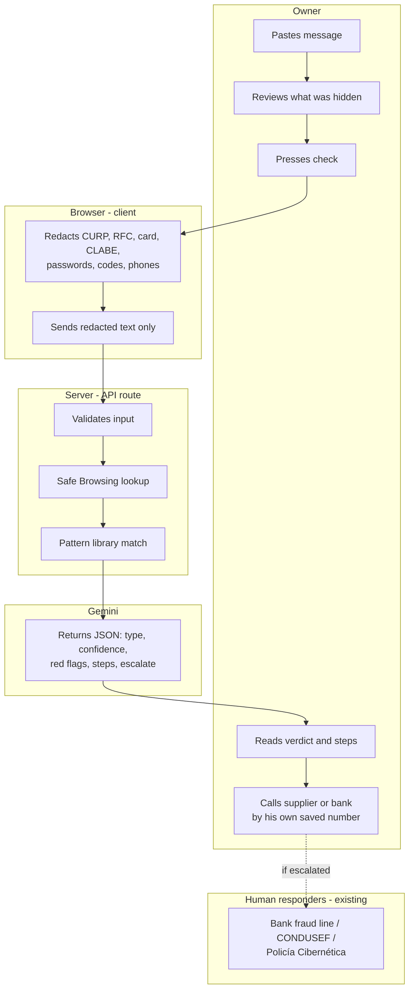

# PACKET — Second Look

> *Before you pay, take a second look.*

**Week 8 · Business Bending · When the Tools Outrun the Safeguards**
**Declared slice (Team 2 Blueprint):** the zero-data / anti-impersonation safety layer of the SME Shield.
**Conditions it most honors:** 6 (shadow clause), plus 3 (human escalation) and 4 (route to existing Mexican institutions).

---

## 1. The problem, in my words

A small Mexican business owner receives a message that *sounds* like someone he trusts: "I'm your supplier, we changed bank accounts, deposit here," "Your SAT mailbox has a fine, pay at this link," "Your package has the wrong address." Today these messages are generic and he catches most of them. AI is changing that: the same message can now name his real supplier, his real order, and arrive without a single spelling mistake. A cloned voice can make "the supplier called me" false proof.

The owner does not feel at risk, has no security team, and will not install anything complicated. What he needs is a **thirty-second second opinion before he pays**, from a tool that never asks him for the very data scammers want.

## 2. Exact user

**Primary user:** the owner of a small Mexican business (1–20 employees), not technical, runs the business on WhatsApp and phone calls. His accountant handles invoicing and the e.firma. He has never used a security product.

**Not the user (this week):** accounting firms, IT providers, banks. They appear in the long view as distribution partners.

**Persona for testing:** *Don Ramiro, 56, runs a small family manufacturing workshop. Uses WhatsApp every day but distrusts new apps. Reads slowly on his phone. If a screen confuses him, he closes it without saying anything.*

## 3. Success definition

**Before the module closes:** Don Ramiro pastes a "supplier changed account" message into the live URL and, in under 30 seconds, gets (a) a plain-language verdict, (b) the type of scam it resembles, and (c) three concrete safe steps, **while no CURP, RFC, card number, CLABE, password or code ever leaves his browser**, which can be shown on screen.

## 4. Mockup (image-generated)

Prompt used for the image generator:

> Mobile app screen mockup, clean and calm, white background with deep green accents. App name "Second Look" at the top with a small magnifying-glass-over-shield icon. Below, a large text box with a pasted WhatsApp message in Spanish: "Hola Don Ramiro, soy Luis de Ceras del Valle, cambiamos de banco, deposite el pedido a esta cuenta..." Some parts of the message are replaced by grey pills that say "[ACCOUNT HIDDEN]". Under the box, a small green note: "4 private details hidden before checking — nothing was sent." A big rounded button: "Take a second look". Below it, a result card with an amber header "Likely scam: supplier account change", a confidence bar at 85%, three numbered steps ("Do not deposit yet", "Call your supplier at the number you already have", "If you already paid, call your bank now"), and a small grey label "Pattern library: simulated data". Flat design, large readable fonts, iPhone frame.

## 5. How it works (flowchart)

## 6. Who does what (swimlane)

## 7. Benchmark line

**The best existing solution on Earth for this is** Singapore's **ScamShield**, a government app where citizens check a number, a message, or a link, and can upload WhatsApp or SMS screenshots that an AI classifier evaluates.

**Mine differs and localizes by** never collecting the sensitive data in the message (it is redacted in the browser before anything is sent), being built for Mexican scam scripts aimed at small business owners (supplier account changes, fake SAT and plate fines), and routing to Mexican responders instead of a government that, in Mexico, has denied its own breaches.

## 8. Long view (3 years)

If this slice works, Second Look becomes the "check before you pay" layer of an SME Shield that accounting firms, banks and business associations hand to their clients for free, the way Australia's IDCARE is funded by organizations rather than victims. It grows from pasted text to screenshots and voice notes, and adds a verified-channels registry so a business can publish its real accounts and its customers can check a message against it. The zero-data rule stays load-bearing at every stage: the product never becomes a database worth stealing.

## 9. Scope cut (NOT building this week)

- No accounts, login, or history (nothing personal is stored, so none is needed).
- No screenshot/OCR or voice analysis.
- No automatic reporting to authorities; the owner decides and calls.
- No browser extension or WhatsApp bot.
- No real breach database; the pattern library is **simulated and labeled as such**.
- No antivirus, no password manager (forbidden zone).

## 10. Architecture and stack

| Layer | Choice | Why |
|---|---|---|
| Frontend | Next.js (App Router) + Tailwind | Same stack as previous weeks |
| Redaction | Client-side TypeScript (regex + Luhn check) | Private data never leaves the browser |
| API | Next.js route `POST /api/check` | Keeps API keys server-side |
| Security tooling | Google Safe Browsing Lookup API v4 | Free for non-commercial use; real threat lists |
| LLM | Gemini API (structured JSON output) | Already used in Rumbo; free tier |
| Third piece | Simulated scam pattern library (`data/patterns.json`, ~8 Mexican scripts) | Structured breach/scam data, labeled simulated on screen |
| Hosting | Vercel | Live URL, env vars for keys |
| Database | **None** | Zero-data rule; nothing to breach |

**Security floor:** keys only in Vercel environment variables; no personal data stored so no auth required; input validated (max 2,000 characters, max 5 links); demo uses invented messages only.

**Redaction targets:** CURP, RFC, 16-digit card numbers (Luhn-checked), 18-digit CLABE, phone numbers, emails, and anything after words like "contraseña", "NIP", "PIN", "código", "token".

## 11. Test plan

| # | Test | Expected |
|---|---|---|
| 1 | Paste a message containing a CURP, RFC, CLABE and card number | All four replaced with tags; on-screen note lists 4 hidden items |
| 2 | Inspect the network request in DevTools | Payload contains only the redacted text |
| 3 | "Supplier changed account" message | Verdict: likely scam; type: supplier account change; 3 steps |
| 4 | Message with a known test-malicious URL (Google's test URLs) | Safe Browsing flags it; escalation card shown |
| 5 | A normal, harmless message ("Your order is ready, pick it up Friday") | Low-risk verdict, no escalation |
| 6 | Empty input and a 5,000-character input | Clear error message; no API call |
| 7 | Gemini unavailable (bad key in preview) | Friendly fallback using pattern library only, labeled |
| 8 | Persona test (Don Ramiro) via screenshots | Log of confusions; worst one fixed and redeployed |
